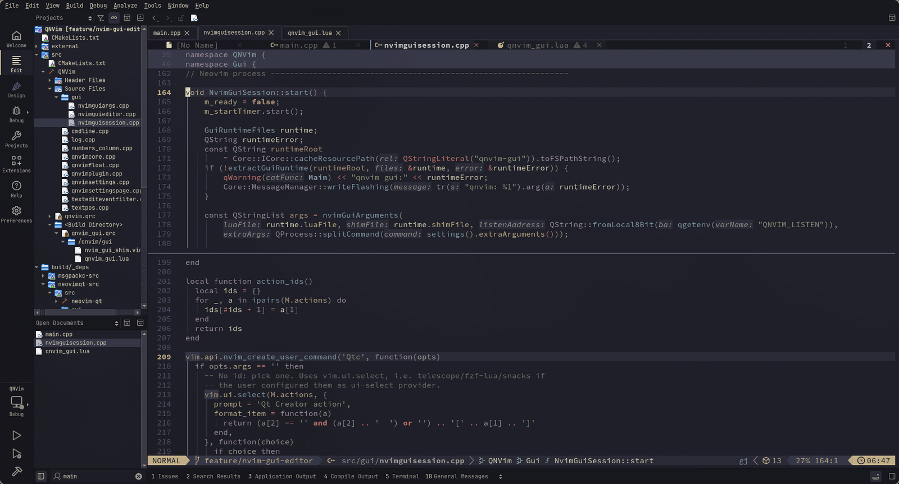
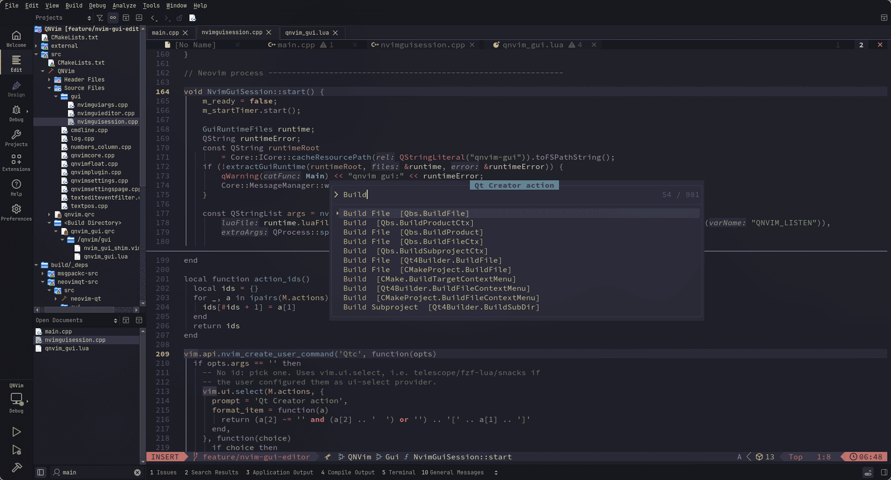
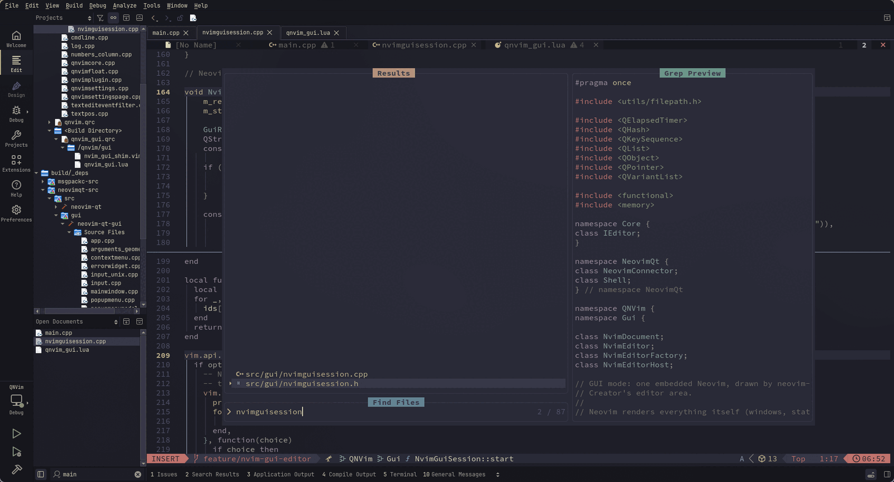

# qnvim

qnvim is a [Qt Creator](https://www.qt.io/product/development-tools) plugin that
embeds a real [Neovim](https://neovim.io) as Qt Creator's code editor. It has
two modes:

- **Neovim GUI** (default): Neovim's whole screen is drawn in Qt Creator's
  editor area, like nvim-qt. Every plugin, window, menu, the command line and
  messages look and behave exactly as in Neovim; Qt Creator keeps its project
  tree, builds, debugger, locator and output panes around it. See
  [Neovim GUI mode](docs/gui-mode.md).
- **Classic**: Neovim owns the buffers, windows, cursor, command line and
  messages; Qt Creator's own text editors render the text.

## Screenshots

Neovim GUI mode (the default): Neovim's windows, bufferline, statusline and
plugins are drawn in Qt Creator's editor area, with the project tree, open
documents and output panes around them.

Qt Creator actions from Neovim: `:Qtc` opens the action list with the configured
`vim.ui.select` provider and runs the selected action in Qt Creator.

Telescope file finding from Neovim: `<Space><Space>` opens LazyVim's file
picker with fuzzy search, a preview of the selected file and its results list.

An older classic-mode demo is on
[YouTube](https://www.youtube.com/watch?v=twwnnduujzw).

## Features

The list below describes classic mode; for GUI mode see
[Neovim GUI mode](docs/gui-mode.md).

- **A real Neovim.** qnvim spawns the `nvim` found in `PATH` and runs your
  configuration and plugins. Neovim is not emulated.
- **Qt Creator splits are Neovim windows.** `:split`, `:vsplit` and Qt Creator's
  own splits are kept as counterparts, with each window keeping its own buffer,
  cursor and viewport.
- **Floating windows.** Completion menus, hover documentation, pickers and
  dashboards are shown as overlays with Neovim's text, colors and stacking.
- **Command line and messages.** Neovim's command line lives in the editor view,
  and long or multiline messages are shown in full.
- **IDE integration.** Use `:Build`, `:Run` and friends, or trigger a registered
  Qt Creator command by id.
- **Neovim's view behavior.** Line numbers, wrapping and scrolling follow
  Neovim, and help pages and terminal buffers open in editor views.

See [Features](docs/features.md) for the full behavior.

## Requirements

- Qt Creator matching the plugin version. `master` targets Qt Creator 20.0.2;
  see [`external/qtcreator/version.cmake`](external/qtcreator/version.cmake).
- Neovim in `PATH`. qnvim is developed against Neovim 0.12.6; older releases
  may work but are not tested.
- To build: Qt 6.8+ development files, CMake 3.22+, a C++20 compiler, and
  network access on the first configure.

Windows, Linux and macOS are supported.

## Installation

Download a release matching your Qt Creator version from the
[releases page](https://github.com/sassanh/qnvim/releases) and install it
through *Help > About Plugins > Install Plugin...* (*Qt Creator > About
Plugins* on macOS). Release archives are built from tags and may lag behind
`master`.

To build from source, see [Building and installing](docs/building.md).

## Configuration

Add a `qnvim.vim` next to your `init.vim`/`init.lua`; qnvim exposes its path as
`$MYQVIMRC` and sources it at startup. From it you can trigger Qt Creator
commands through `g:neovim_channel`.

See [Configuration](docs/configuration.md) and
[`examples/qnvim.vim`](examples/qnvim.vim).

## Documentation

See the [documentation index](docs/index.md).

## Status

qnvim is stable for day-to-day editing. The remaining limitations are documented
in [Limitations](docs/limitations.md).

## Credits

- [Neovim](https://neovim.io)
- [Qt](https://www.qt.io)
- [Qt Creator](https://www.qt.io/product)
- [Neovim Qt](https://github.com/equalsraf/neovim-qt)

## License

MIT. See [LICENSE](LICENSE). Release builds include third-party code; see
[THIRD-PARTY-NOTICES.md](THIRD-PARTY-NOTICES.md).
